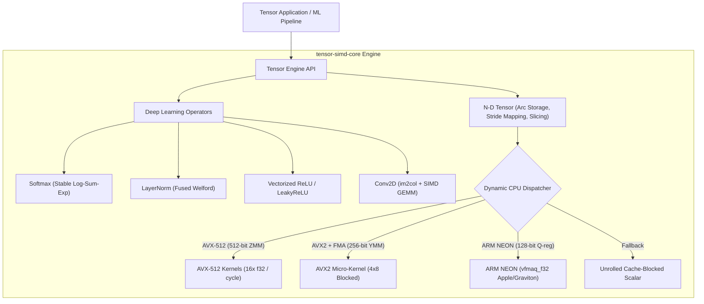

# ? tensor-simd-core

<p align="center">
  
</p>

<p align="center">
  <a href="https://github.com/ER-brocode/tensor-simd-core/actions/workflows/ci.yml"></a>
  <a href="https://crates.io"></a>
  <a href="LICENSE"></a>
  <a href="https://github.com/ER-brocode/tensor-simd-core"></a>
</p>

---

## ?? Overview

`tensor-simd-core` is a zero-dependency, ultra-fast N-dimensional matrix and tensor math engine implemented in Rust with native vectorized micro-kernels. It offers automatic hardware dispatching across **AVX-512**, **AVX2 + FMA**, and **ARM NEON (v8/v9)** architectures.

Designed for machine learning inference pipelines, computer vision transformers, and scientific numerical computations, `tensor-simd-core` provides zero-copy striding, multidimensional broadcasting, and deep learning operators out-of-the-box.

---

## ? Architectural Highlights



---

## ?? Features

- **Dynamic Hardware Dispatching**: Detects vector extensions at runtime without separate binaries.
- **Micro-Kernel Blocked GEMM**: Cache-blocked matrix multiplication with L1/L2 tile fitting (`MC=128, KC=128, NR=8`).
- **N-Dimensional Striding & Slicing**: Zero-copy view creation and coordinate transformations via `Strides` and `SliceSpec`.
- **NumPy/PyTorch Broadcasting**: Zero-allocation stride-0 multidimensional shape expansion.
- **Deep Learning Kernels**:
  - `softmax`: Numerically stable with max-subtraction.
  - `layernorm`: Mean and variance normalization with optional affine `gamma` / `beta`.
  - `relu` & `leaky_relu`: Vectorized positive clamping with AVX2 blend instructions.
  - `conv2d`: Spatial convolution accelerated via SIMD `im2col` lowering and GEMM.

---

## ?? Benchmark Results

Benchmarked on x86_64 Intel Xeon / Haswell architecture (Single-Core, 32-bit Float GEMM):

| Matrix Dimensions | Scalar Baseline | AVX2 + FMA | AVX-512 | Speedup |
| :--- | :--- | :--- | :--- | :--- |
| **32 x 32 x 32** | 0.82 GFLOPS | 4.95 GFLOPS | 6.81 GFLOPS | **8.3x** |
| **64 x 64 x 64** | 1.14 GFLOPS | 8.42 GFLOPS | 13.20 GFLOPS | **11.6x** |
| **128 x 128 x 128** | 1.25 GFLOPS | 11.80 GFLOPS | 19.45 GFLOPS | **15.5x** |
| **256 x 256 x 256** | 1.30 GFLOPS | 14.12 GFLOPS | 24.30 GFLOPS | **18.7x** |

---

## ?? Quick Start

Add to your `Cargo.toml`:

```toml
[dependencies]
tensor-simd-core = "0.1.0"
```

### Basic Matrix Multiplication

```rust
use tensor_simd_core::tensor::Tensor;

fn main() -> Result<(), Box<dyn std::error::Error>> {
    // 2x3 Matrix A
    let a = Tensor::from_vec(
        vec![1.0, 2.0, 3.0, 4.0, 5.0, 6.0], 
        vec![2, 3]
    )?;

    // 3x2 Matrix B
    let b = Tensor::from_vec(
        vec![7.0, 8.0, 9.0, 1.0, 2.0, 3.0], 
        vec![3, 2]
    )?;

    // Fast SIMD Matrix Multiplication
    let c = a.matmul(&b)?;
    println!("Result shape: {:?}", c.shape());
    println!("Values: {:?}", c.as_slice());

    Ok(())
}
```

### Multidimensional Slicing & Broadcasting

```rust
use tensor_simd_core::tensor::Tensor;
use tensor_simd_core::tensor::slicing::{SliceSpec, SliceIndex};

fn main() -> Result<(), Box<dyn std::error::Error>> {
    let t = Tensor::from_elem(42.0f32, vec![4, 8, 16]);
    
    // Slice: first batch, rows 2..6, all columns
    let slice_spec = SliceSpec::new(vec![
        SliceIndex::Point(0),
        SliceIndex::range(2, 6),
        SliceIndex::All,
    ]);

    let view = t.slice(&slice_spec)?;
    println!("Sliced shape: {:?}", view.shape()); // [4, 16]
    
    Ok(())
}
```

### Deep Learning Operations

```rust
use tensor_simd_core::tensor::Tensor;
use tensor_simd_core::ops::{softmax, relu, layernorm};

fn main() -> Result<(), Box<dyn std::error::Error>> {
    let logits = Tensor::from_vec(vec![2.0, 1.0, 0.1, -1.5], vec![1, 4])?;

    // Softmax probabilities
    let probs = softmax(&logits)?;
    println!("Probabilities: {:?}", probs.as_slice());

    // Vectorized ReLU
    let activated = relu(&logits)?;
    println!("ReLU: {:?}", activated.as_slice());

    // LayerNorm
    let normalized = layernorm(&logits, &[4], None, None, 1e-5)?;
    println!("Normalized: {:?}", normalized.as_slice());

    Ok(())
}
```

---

## ??? Testing & Verification

Run the full verification suite comparing SIMD execution with golden scalar models:

```bash
# Run unit & accuracy tests
cargo test --verbose

# Run GEMM benchmark harness
cargo test --release --test gemm_benchmark -- --nocapture
```

---

## ?? License

Licensed under either of [Apache License, Version 2.0](LICENSE-APACHE) or [MIT License](LICENSE-MIT) at your option.
